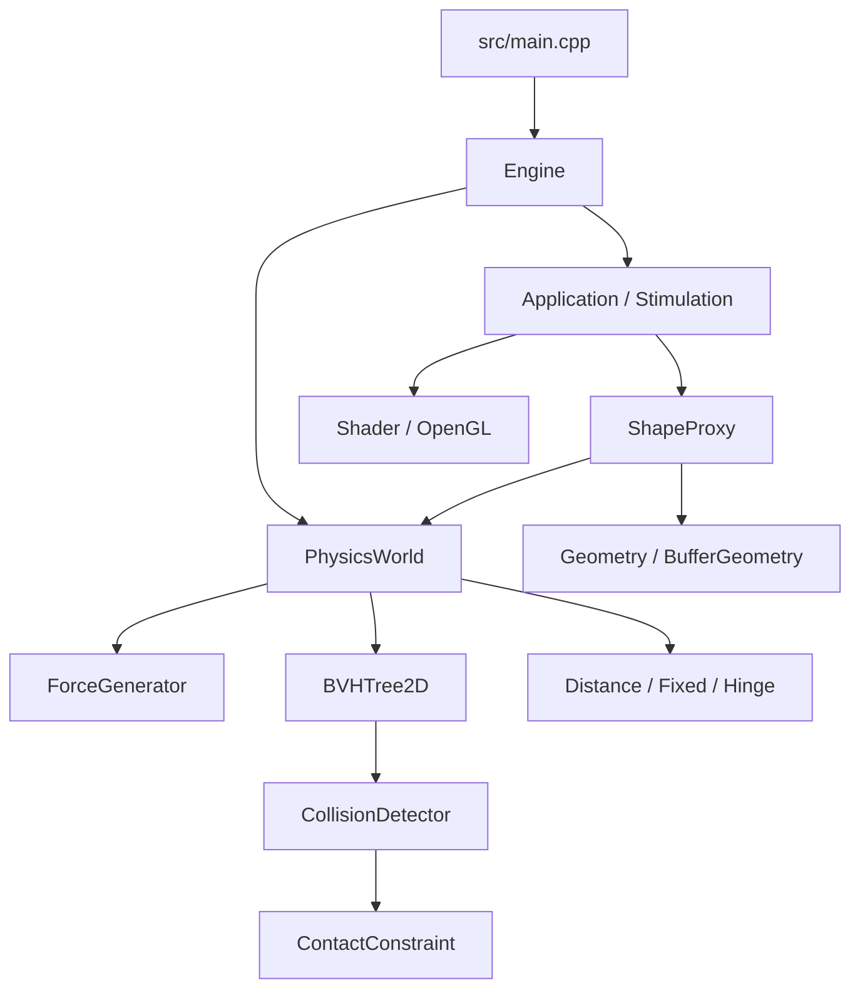
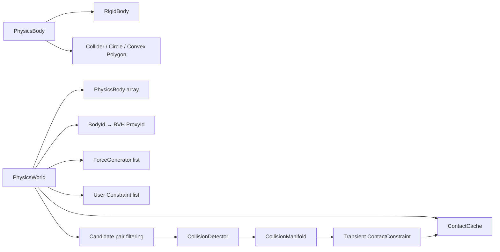

# 架构概览

项目将窗口与渲染、应用场景和物理模拟放在不同目录中。当前演示通过 `ShapeProxy` 把可绘制几何体与 `PhysicsWorld` 中的刚体关联起来。应用层负责组装场景和提供每帧更新；物理层维护模拟状态并执行碰撞与约束求解；渲染层根据物理变换提交 OpenGL 绘制。

## 模块关系



## 运行时数据流

```mermaid
sequenceDiagram
    participant Loop as Engine::Run
    participant App as Application
    participant World as PhysicsWorld
    participant BVH as BVHTree2D
    participant Detector as CollisionDetector
    participant Solver as Contact / User Constraints
    Loop->>World: Step(frameDeltaTime)
    loop 每个物理子步
        World->>World: 力生成器与刚体积分
        World->>BVH: 更新 AABB 代理并查询候选对
        BVH-->>World: 候选 BodyId 对
        World->>Detector: 对候选对做窄相检测
        Detector-->>World: CollisionManifold
        World->>Solver: Prepare / Restore / WarmStart
        World->>Solver: 多轮速度求解与位置修正
    end
    Loop->>App: Update(frameDeltaTime)
    App->>App: 输入处理、读取物理变换并绘制
```

## 主要目录与职责

| 路径 | 职责 |
|---|---|
| `engine/src/Engine.*` | 创建 OpenGL 窗口、维护主循环、接收应用对象，并持有 `PhysicsWorld`。 |
| `engine/src/Geometry/` | `BufferGeometry` 及圆形、多边形等绘制几何。 |
| `engine/src/Render/` | 着色器加载与 uniform 设置。 |
| `engine/src/Input/` | 键盘和鼠标状态。 |
| `engine/src/Physics/RigidBody.hpp` | 刚体状态、运动类型、力和冲量接口。 |
| `engine/src/Physics/Collider.hpp` | 圆形和凸多边形碰撞数据。 |
| `engine/src/Physics/BroadPhase/` | AABB 与二维 BVH 动态树。 |
| `engine/src/Physics/Collision/` | 窄相碰撞检测、接触流形、接触约束和冲量缓存。 |
| `engine/src/Physics/Constraints/` | 持续存在的用户约束。 |
| `engine/src/Physics/Forces/` | 力生成器，例如弹簧。 |
| `include/ShapeProxy.hpp` | 当前演示中的渲染对象与物理刚体桥接。 |
| `include/Stimulation.hpp` | 当前交互演示场景。 |

## 核心对象与职责

| 对象 | 保存的数据 | 主要职责与生命周期 |
|---|---|---|
| `Engine` | GLFW 窗口、输入状态、应用指针和 `PhysicsWorld` | 初始化 OpenGL 与回调；每帧先推进物理，再调用应用更新和交换缓冲区。 |
| `Application` | 应用定义的场景对象 | 通过 `Init` 构造场景，通过 `Update` 响应输入并绘制。当前接口是纯虚基类。 |
| `ShapeProxy` | `shared_ptr<Shape>` 与 `BodyId` | 演示层桥接。创建物理刚体，并通过其变换绘制对应网格；运动学代理还能写入速度。 |
| `PhysicsWorld` | `PhysicsBody` 数组、BVH 代理、力生成器、持久约束和接触缓存 | 管理一帧中的子步、碰撞对收集和统一求解顺序。 |
| `PhysicsBody` | `RigidBody`、`Collider` 和当前 AABB | 将物理状态与其碰撞形状组合为世界中的一个对象。 |
| `RigidBody` | 变换、速度、质量倒数、惯量倒数、材质和碰撞过滤位 | 执行运动积分，提供点速度、力和冲量操作。 |
| `Collider` | `CircleCollider` 或 `PolygonCollider` | 保存窄相检测使用的物理几何，与 GPU 网格分开。 |
| `ContactConstraint` | 一个碰撞对的 manifold 和逐点冲量状态 | 每个子步由碰撞结果创建，子步结束后销毁；冲量可写入 `ContactCache`。 |
| `Constraint` / `ForceGenerator` | 持久约束参数或力生成器参数 | 由 `PhysicsWorld` 持有并在每个子步调用。 |

`PhysicsWorld` 目前将刚体存放在连续数组中，`BodyId` 是数组索引。当前没有公开的刚体销毁和 ID 复用流程；BVH 代理自身则用带 generation 的 `ProxyId` 检查代理句柄是否仍有效。

## 物理模块内部关系



`RigidBody` 不包含顶点；`Collider` 不包含 VAO/VBO；`Shape` 不承担物理质量或碰撞逻辑。它们通过稳定的数据接口协作，避免碰撞算法依赖绘图缓冲区。当前应用层仍通过单例 `Engine` 获取 `PhysicsWorld`，所以这个分层减少了几何数据耦合，但还没有把物理系统打包成完全独立的 headless 库。

## 一帧中的物理调用

`Engine::Run` 每帧计算经过时间并调用 `PhysicsWorld::Step`。世界将时间分为多个子步；每个子步大致执行以下操作：

1. 力生成器向动态刚体累加力和扭矩。
2. 刚体积分力、重力、速度和变换。
3. 更新刚体 AABB，并由 BVH 查询可能相交的候选对。
4. 根据碰撞类别和掩码过滤候选对，执行窄相检测并创建本子步的接触约束。
5. 准备接触与用户约束，恢复可匹配的接触缓存并 warm start。
6. 对接触和用户约束交替执行速度迭代，再执行位置修正迭代。
7. 清理过期的接触缓存记录。

当前速度求解和位置修正迭代次数在 `PhysicsWorld.cpp` 中设置。`PhysicsWorld::Step` 默认使用 5 个物理子步；子步数和约束迭代数是两个不同概念。

### 每个子步的几个阶段

1. `ForceGenerator::Apply`：例如弹簧根据当前锚点位置和速度累计力/扭矩。
2. `RigidBody::Update`：动态刚体先积分重力和力，再积分线速度/角速度得到新变换；运动学刚体只积分其给定速度。
3. AABB 更新：圆形用圆心与半径生成边界，多边形将局部顶点变换到世界空间后求 min/max。
4. Broad phase：通过 BVH 找候选，跳过 ID 顺序重复对、无效对象、过滤不通过对象和静态/静态对象对。
5. Narrow phase：碰撞检测输出 manifold；每个碰撞对创建一个 `ContactConstraint`，流形中的每个接触点有自己的冲量状态。
6. 求解：所有接触和用户约束先准备并 warm start，再交替进入速度迭代；随后进入位置修正迭代。
7. Cache maintenance：清理一定数量子步内未再次匹配到的接触特征。

这个顺序意味着离散碰撞检测使用的是本子步积分后的变换。子步可以降低高速物体穿越的概率，但不能替代 CCD。

## 当前模块边界

`RigidBody`、`Collider`、窄相检测和求解器位于物理目录中。渲染几何负责 OpenGL 缓冲区，`ShapeProxy` 则通过物理句柄读取刚体变换并绘制对应形状。当前应用和演示仍使用 `Engine` 单例，因此物理模块还没有作为独立、无窗口的库完全拆分出来。

## 图形、输入与演示应用

- **`Engine`：** 创建 GLFW 窗口并请求 OpenGL 3.3 Core Profile；创建上下文后加载 GLAD，再初始化应用。主循环轮询事件、计算帧间隔、推进物理、调用应用更新并交换前后缓冲区。
- **`Application`：** 场景生命周期接口只有 `Init` 和 `Update`。引擎保存的是非拥有型应用指针；当前 `main.cpp` 在引擎运行期间保持 `Stimulation` 对象存活。
- **`InputManager`：** GLFW 键盘/鼠标回调更新输入状态。演示每帧读取按键并设置 Kinematic 三角形速度；运动物体仍由物理世界积分变换。
- **`BufferGeometry`：** 保存顶点和索引，并管理 OpenGL VAO/VBO/EBO。顶点结构包含位置、法线与 UV；当前演示主要绘制简单的 2D 形状。
- **`Shape` 与具体几何：** `Circle`、`Polygon` 等几何类生成供渲染使用的顶点/索引，并通过 `BufferGeometry` 上传到 GPU。形状几何不直接充当碰撞查询接口。
- **`Shader`：** 从着色器文件加载并编译 GLSL 程序，提供矩阵和颜色 uniform 的设置接口。
- **`ShapeProxy`：** `PullModelTransform` 从对应 `PhysicsBody` 读取变换并创建 model 矩阵，`Draw` 负责绑定 VAO 和发出索引绘制调用。

OpenGL 上下文在 `Application::Init` 前创建，因为当前几何构造会生成 GPU 资源。这个顺序适合实时演示，但意味着当前 `Shape` 不能在无窗口环境中直接实例化；独立物理验证应绕过 `ShapeProxy` 和绘图几何，只使用 `PhysicsWorld`、`RigidBody` 与 `Collider`。

添加新碰撞形状时，需要同时定义碰撞数据、AABB 计算和窄相配对；添加新的约束时，可实现 `Constraint` 接口中的准备、warm start、速度求解和位置求解阶段。渲染对象不应作为碰撞几何的替代数据源。

## 扩展入口

### 添加碰撞形状

1. 在 `Collider.hpp` 增加形状数据，并加入 `ColliderData` variant 和 `ColliderType`。
2. 在 `PhysicsWorld::ComputeBounds` 中实现该形状的世界 AABB。
3. 在 `CollisionDetector::Detect` 中增加对应类型分派，并实现窄相碰撞函数。
4. 为每个接触结果填入统一 A→B 法线、接触点、分离量、局部锚点和可复现的 feature ID。
5. 若形状有质量分布，在 `MathHelper::CalculateInertia` 中补充惯量计算。

### 添加约束或外力

- 约束实现继承 `Constraint`，将本子步重复使用的锚点偏移、有效质量和偏差项放在 `Prepare` 中计算；在 `WarmStart` 恢复已有累积冲量，再实现速度和位置阶段。
- 外力逻辑实现 `ForceGenerator`，只通过 `PhysicsWorld` 获取刚体并累计力/扭矩；积分仍由 `RigidBody` 统一处理。

### 当前架构限制

- `ShapeProxy` 通过 `Engine` 单例访问世界，方便演示但让应用层与全局引擎实例相连。
- `PhysicsWorld` 直接负责 broad phase、接触创建和求解调度；尚未拆分为独立的 `BroadPhase`、`NarrowPhase`、岛构建或可配置求解器对象。
- `BodyId` 没有删除/复用机制；BVH 的代理句柄有 generation 校验，但这不会自动解决刚体数组生命周期问题。
- 物理模块未配套独立单元测试目标。当前 OpenGL 演示需要图形上下文，算法验证尚未完全从渲染应用中分离。
